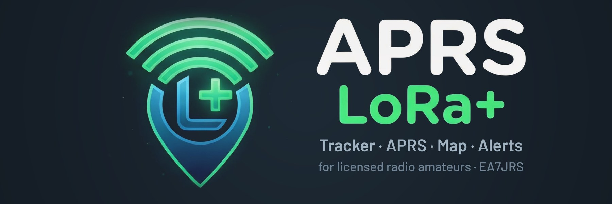

# APRS LoRa+ for Android

Android companion for the [APRS LoRa+](https://github.com/EA7JRS/APRS-LoRa-Plus) tracker (ESP32 firmware). It talks to the tracker over **Bluetooth LE (KISS)**.

Status: **5.4.6**, same version number as the tracker. The pure Kotlin core is tested (about 1500 checks); the Android app builds in the CI but has not been tried on a phone yet.

## What it does (version 1 plan)
- Connects to the tracker over BLE (KISS service `00000001-ba2a-46c9-ae49-01b0961f68bb`) and keeps the link in a foreground service.
- Station list with **Go to**: opens the route to the station's last position in Google Maps.
- APRS messaging: write, answer, acknowledgements with retries, duplicate removal.
- Messages arrive as notifications with reply / mark-as-read actions, so Android Auto reads them aloud and lets you answer by voice.
- Mobile iGate (radio -> APRS-IS only).
- **Tracker control** (firmware with the BLE control service, `docs/BLE_CONTROL.md`): radio mode (APRS LoRa / FSK, Morse, WSPR, FT8, FT4, FST4W, LR-FHSS, DAPNET; the tracker restarts), beacon profile, LoRa profile, beacon now, digipeater, CW messages.
- **Sensors and GNSS** of the tracker: battery, temperature, humidity, pressure, QNH, barometric altitude, magnetic heading, IMU; position, speed, satellites, HDOP.
- **DAPNET**: pages received by the tracker (DAPNET mode) as notifications; pages sent from the phone through the DAPNET API (account needed).
- **NMEA**: TCP server for other apps (OpenCPN, Navionics...) with the tracker's sentences, including APRS stations as AIS targets (boards with NMEA output; otherwise RMC/GGA built by the phone), and the tracker's GNSS as the phone location (mock location).
- **Telegraph key on the phone** (tracker in MORSE mode): keyboard-type USB/Bluetooth adapters (VBand, Vail: Left Ctrl / `[` = dit, Right Ctrl / `]` = dah), MIDI (Vail: note 0 timed key, 1 dit, 2 dah) and USB serial (FTDI, CP210x, CH34x, PL2303, CDC; key on DSR/CTS/CD/RI). Straight key or iambic A/B keyer on the phone, sidetone on the phone, real-time keying replayed by the tracker with a fixed delay, or text mode.
- **Firmware**: installed and published versions; update over Bluetooth (boards with a second firmware slot: the phone downloads the published image, checks size and SHA-256, the tracker checks it again and activates it), update with the tracker's own WiFi, and the web installer (USB OTG cable, Chrome) for every board.
- **VOR** (SDR tab): the VOR beacons within reach (OurAirports, public domain) with distance, bearing, elevation and radio range; TUNE in AM, ROTOR, and with the app's RTL-SDR, MEASURE the carrier for 10 s to get the receiver error in ppm and APPLY the correction.
- **NAVTEX** (Modes): SITOR-B decoder ported from fldigi (518 / 490 / 4209.5 kHz, radio in USB or the app receiver), messages kept on the phone with the station that sent them, the stations within reach with their next broadcast, positions in the text to GO TO / ROTOR, and the alarm window for search and rescue (subject D).
- **DSC** (Modes > DSC VHF / DSC HF): ITU-R M.493 decoder for channel 70 (1200 baud, 1300 / 2100 Hz on FM) and the MF / HF DSC channels (100 baud, 170 Hz), after SDRangel's decoder (time diversity with soft decisions, ECC): distress alerts, relays, acknowledgements, all-ships, individual, group and area calls, with position, nature and time; TUNE puts the SDR or the CAT radio on the channel; the DSC DISTRESS window (also in Android Auto) and each call out of the NMEA server as `$CDDSC` for the plotter.
- **406 MHz beacons** (SDR > 406 MHz distress beacons): Cospas-Sarsat first-generation EPIRB / ELT / PLB with the app's RTL-SDR on 406.031 MHz (30 kHz covers every channel): carrier detection per spectrum bin, biphase-L phase demodulation, both BCH codes, standard / national / user-location protocols, 15-hex ID, position with GO TO / ROTOR, and the 406 MHz DISTRESS BEACON window (not for self-tests).
- **Celestial navigation** (Sextant tool): Sun, Moon, Venus, Mars, Jupiter, Saturn and 157 stars computed on the phone to almanac precision, a list of the bodies visible now with the three stars that best cross, altitude corrections (index error, dip, refraction, semi-diameter, parallax), intercept and azimuth from the assumed position, up to four lines advanced for the run, and the fix; compass check (total correction from the compass bearing of a body, deviation, and a deviation card with the A–E coefficients).
- **Callsign validation**: the callsign must have a DMR ID / CCS7 in RadioID.net; until then the app only listens.

## Layout
- `core/`: pure Kotlin (no Android): KISS, AX.25, TNC2, APRS parsing, message engine, iGate rules, geo. `gradle :core:selfTest` runs its checks.
- `app/`: Android app (Compose UI, BLE client, foreground service, notifications).

## Build
`gradle :core:selfTest` and `gradle :app:assembleDebug` (Android SDK 35, JDK 17). The GitHub workflow does both and uploads the debug APK.

## Not done yet
APRS telemetry; saving messages, stations and pages between runs; distance and bearing from your own position; position beacons from the phone; Android Auto station list; TCP KISS link; AIS built by the phone for boards without NMEA output.

License: GPL-3.0-or-later.
